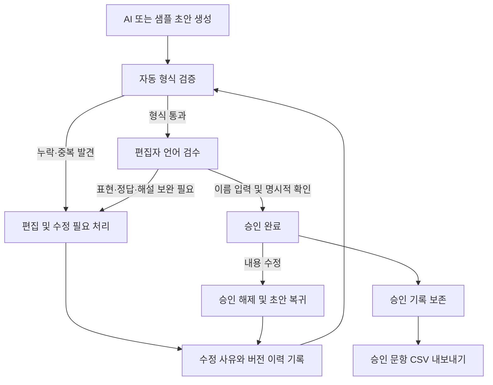

# KotobaLab

**일본어 교재 연구원과 편집자를 위한 AI 문항 초안 생성·검수 도구**

JLPT N1·N2 어휘·문법 문항을 생성하고, 편집자가 문제와 해설을 수정·검수한 뒤 승인하는 Python 웹 애플리케이션입니다. 승인 문항은 CSV로 내보내고, 수정 과정은 버전별 이력으로 추적할 수 있습니다.

AI가 만든 결과를 바로 교재에 사용하는 대신, **자동 형식 검사와 사람의 언어 검수를 구분하는 편집 과정**을 구현한 로컬 실행형 MVP입니다. API 키 없이 샘플 모드로 주요 기능을 확인할 수 있습니다.


## 개발 배경과 목적

일본어 교육 문항은 문제와 정답만 만들면 끝나는 작업이 아닙니다. 다른 선택지도 정답이 될 수 있는지, 오답이 학습 목표에 적절한지, 문법 해설에 잘못된 단정이 없는지 검토해야 합니다.

KotobaLab은 이 과정을 지원하기 위해 만들었습니다. AI는 초안을 제안하고, 시스템은 누락과 중복을 검사하며, 편집자는 일본어의 자연스러움·정답의 유일성·해설의 정확성을 최종 판단합니다. 수정 이유와 승인 기록을 남겨 문항이 어떻게 다듬어졌는지 확인할 수 있도록 설계했습니다.

## 주요 기능

| 기능 | 구현 내용 |
| --- | --- |
| 문항 초안 생성 | N1/N2, 어휘/문법, 주제를 선택해 4지선다 문항 생성 |
| 문제·해설 편집 | 문제, 선택지 4개, 정답 번호, 정답 해설, 선택지별 해설 수정 |
| 자동 형식 검증 | 선택지 중복·누락, 정답 누락·범위 오류, 정답 및 오답별 해설 누락 검사 |
| 편집자 검수·승인 | 초안·수정 필요·승인 완료 상태 관리. 승인에 편집자 이름과 명시적 확인 요구 |
| 수정 이력 | 수정 전후 내용, 수정 사유, 편집자, 시각, 버전·상태 변경 보존 및 비교 |
| CSV 내보내기 | 필수 해설과 승인 정보가 완전한 승인 문항만 내보내기 |
| 샘플 모드 | API 키 없이 생성·편집·검수·승인·이력·CSV 기능 체험 |

샘플은 프로젝트용으로 작성한 고정 예시 4종이며 공식 JLPT 기출문제가 아닙니다. 샘플 모드의 주제는 분류용이고 예시 내용은 바뀌지 않습니다. 주제에 맞춘 새 문항은 OpenAI API 모드에서 생성합니다.

## 문항 제작 흐름



1. **초안 생성:** 레벨·영역·주제를 선택합니다. 생성 문항은 항상 초안으로 저장됩니다.
2. **형식 검증:** 필수 항목의 누락과 선택지 중복을 확인합니다. 검증 버튼은 저장하지 않습니다.
3. **편집자 검수:** 자연스러운 일본어인지, 다른 정답이 가능한지, 해설이 정확한지 검토합니다.
4. **승인 또는 수정 필요:** 편집자 이름을 입력하고 상태를 저장합니다. 승인에는 별도의 검수 확인 체크가 필요하며 형식 오류가 있으면 차단합니다.
5. **수정 이력 관리:** 저장 전후 내용, 검수 메모, 편집자, 수정 사유, 상태·버전 전환을 기록합니다.
6. **CSV 내보내기:** 승인 문항 중 현재 형식 기준을 충족하는 문항을 UTF-8 BOM CSV로 다운로드합니다. 제외 문항은 ID와 사유를 안내합니다.

### 형식 검증과 언어 검수의 경계

| 자동으로 검사하는 것 | 편집자가 최종 판단하는 것 |
| --- | --- |
| 선택지가 4개인지, 중복·빈 값이 있는지 | 선택지가 자연스럽고 학습 목표에 적절한지 |
| 정답 번호가 선택지 범위 안에 있는지 | 정답이 하나뿐인지, 다른 선택지도 성립하는지 |
| 정답 해설과 개별 해설 4개가 채워졌는지 | 문법 설명과 각 오답의 근거가 정확한지 |
| 필수 메타데이터가 있는지 | JLPT 레벨과 난도가 적합한지 |

정답 선택지의 개별 해설도 필수입니다. 별도의 정답 해설이 있어도 생략할 수 없습니다. AI 생성과 형식 검증 통과는 언어적 정확성을 보증하지 않으며 자동 승인은 수행하지 않습니다.


## 문제 해결 경험: 「以降・以来」 문항 검수

실제로 생성·저장된 문항을 검토하면서 **형식이 완전해도 교육 문항의 품질은 보장되지 않는다**는 문제를 확인했습니다.

```text
彼は2020年4月入社（　）、ずっと同じ会社で働いている。

1. 以降   2. 以来   3. 以来以降   4. 以後
AI가 지정한 정답: 2번 以来
```

| 발견한 문제 | 검수 판단과 대응 방향 |
| --- | --- |
| 복수 정답 가능성 | 以来는 과거의 시점부터 이어지는 상태에 적합하지만, 이 문장만으로 以降나 以後를 명확히 배제하기 어렵다고 판단했습니다. 뉘앙스 차이를 곧바로 정답·오답의 차이로 단정할 수 없습니다. |
| 부적절한 오답 | 以来以降은 표현을 단순 결합한 부자연스러운 선택지여서, 두 표현의 차이를 이해했는지 평가하는 오답으로 적절하지 않다고 판단했습니다. |
| 해설의 과도한 단정 | “以降는 상태의 지속을 강조하는 문맥에 적합하지 않다”는 설명은 해당 선택지가 반드시 틀렸다는 근거로 충분하지 않았습니다. |

사전 자료는 以後·以降의 용법이 겹치고 以来가 특정 시점부터 이어지는 의미를 나타낸다고 설명합니다. 이를 바탕으로 위 문항의 정답 유일성에 재검수가 필요하다고 판단했습니다. [小学館 사전 자료: 以後·以降 비교](https://kotobank.jp/word/%E4%BB%A5%E5%BE%8C-431678), [以来의 의미](https://kotobank.jp/word/%E4%BB%A5%E6%9D%A5-436281).

이 사례를 통해 **자연스럽지만 해당 문맥에서는 정답이 될 수 없는 오답을 구성하고, 각 선택지를 배제하는 근거를 편집자가 확인해야 한다**는 검수 기준을 정리했습니다. 개선 방향은 문제 문맥을 다시 설계하고 선택지를 교체한 뒤 수정 사유를 기록해 재검수하는 것입니다.

현재 시스템은 이런 문제를 다룰 수 있도록 수정 필요 상태, 개별 해설 필수 검사, 명시적 승인, 수정 후 승인 해제, 전후 비교 이력을 제공합니다. 다만 이 문항의 수정·재승인이 완료됐다는 의미는 아니며, 복수 정답 가능성을 AI가 자동 판정하는 기능도 구현하지 않았습니다. 이번 포트폴리오 정리에서는 원문과 로컬 데이터를 변경하지 않았습니다.

## 수정 이력과 데이터 보존

- 문항 저장과 이력 추가를 **하나의 SQLite 트랜잭션**으로 처리합니다. 하나가 실패하면 둘 다 취소됩니다.
- 이력은 별도 테이블에 추가하며 이전 내용을 덮어쓰지 않습니다. 문제·선택지·정답·해설·검수 메모·승인 정보를 전후 비교할 수 있습니다.
- 승인된 문항의 실질적 내용을 수정하면 초안으로 복귀하고 승인자·승인 시각을 초기화합니다. 다시 검수·승인해야 합니다.
- 앞뒤 공백, 줄바꿈 방식, JSON 키 순서만 달라진 저장은 버전과 승인을 유지하고 저장 시도만 기록합니다. 문장 내부 공백과 선택지 순서는 실제 변경으로 취급합니다.
- 오래된 버전의 저장은 충돌로 차단합니다. 목록 새로고침 후 최신 내용을 확인할 수 있습니다.
- 기존 DB 마이그레이션은 문항·상태·버전을 보존합니다. 도입 시점의 기준 버전을 기록하며 기록이 없던 과거 수정 과정은 복원하지 않습니다.


## 기술 스택

| 기술 | 사용 목적 |
| --- | --- |
| Python 3.11 이상 | 데이터 처리와 애플리케이션 로직 |
| Streamlit | 문항 생성·편집·검수 화면 |
| OpenAI API | 독창적인 문항 초안 생성 |
| Pydantic | 구조화된 API 응답과 문항 데이터 모델 |
| SQLite | 문항·검수 상태·수정 이력 저장 및 트랜잭션 |
| Pandas | 승인 문항 CSV 생성 |
| pytest / Streamlit AppTest | 모델·저장·검수 규칙 및 화면 흐름 테스트 |

## 실행 방법

### 설치 및 샘플 모드 실행

저장소를 내려받은 뒤 **프로젝트 루트 폴더**에서 실행합니다. 다음 명령은 Windows PowerShell 기준이며 가상환경 활성화가 필요하지 않습니다.

```powershell
py -3.11 -m venv .venv
.\.venv\Scripts\python.exe -m pip install -r requirements.txt
.\.venv\Scripts\python.exe -m streamlit run app.py
```

브라우저에서 <http://localhost:8501>을 엽니다. 왼쪽의 **샘플 (API 키 불필요)**를 선택하고 **초안 생성**을 누르면 시작할 수 있습니다. 저장에는 편집자 이름이 필요하며 수정 사유는 선택 입력입니다.

### OpenAI API 사용 (선택)

```powershell
Copy-Item .env.example .env
```

`.env`에 개인 API 키를 입력한 뒤 앱을 재시작합니다.

```dotenv
OPENAI_API_KEY=YOUR_API_KEY
OPENAI_MODEL=gpt-4.1-mini
```

화면에서 **OpenAI API**를 선택하세요. 호출 비용이 발생하며 해당 계정이 모델에 접근할 수 있어야 합니다. 모델은 OPENAI_MODEL로 변경할 수 있고 Structured Outputs 지원이 필요합니다. 키는 화면이나 문항 DB에 저장하지 않습니다. 구현은 [OpenAI 공식 Structured Outputs 문서](https://developers.openai.com/api/docs/guides/structured-outputs?api-mode=responses)를 참고했습니다.

### 기존 DB의 이력 기능 마이그레이션

새로 실행하면 `data/kotobalab.db`가 자동 생성됩니다. 기존 DB에 이력 기능을 처음 적용할 때는 앱을 종료하고 다음 명령으로 백업 후 마이그레이션할 수 있습니다.

```powershell
.\.venv\Scripts\python.exe scripts\migrate_history.py
```

최초 적용 전 백업은 data/backups/에 저장합니다. 반복 실행 시 기준 이력을 중복 생성하지 않습니다. 기존 DB를 삭제하거나 초기화할 필요가 없습니다.

## 테스트와 검증 범위

**2026년 10월 12일 기준: 자동 테스트 109개 통과.**

```powershell
.\.venv\Scripts\python.exe -m pytest -q
```

검증 범위는 형식 오류, 해설 누락 시 승인 차단, 명시적 승인, 수정 후 승인 해제, CSV 내보내기, 이력 보존, 저장·이력의 동시 롤백, 마이그레이션 데이터 보존, 저장 충돌, Streamlit 화면 흐름입니다.

테스트는 프로젝트의 .pytest-tmp 안에 임시 DB를 사용하며 실제 문항 DB를 변경하지 않습니다. API 테스트는 모의 응답을 사용하므로 키와 호출 비용이 필요하지 않습니다. 실제 API 연결과 문항의 언어적 품질까지 자동 테스트가 보증하는 것은 아닙니다.


## 프로젝트 구조

```text
app.py                       Streamlit 화면
kotobalab/
  models.py                  문항 모델과 형식 검증
  generator.py               OpenAI API 연동
  samples.py                 샘플 문항
  db.py                      SQLite 저장·승인 규칙·이력 마이그레이션
  history.py                 변경 판별과 전후 비교
  export.py                  승인 문항 CSV 내보내기
tests/                       자동 테스트
scripts/migrate_history.py    기존 DB 백업 및 마이그레이션
scripts/prepare_demo.py       실제 데이터와 분리된 촬영용 DB 준비
kotobalab/runtime.py          명시적 데모 모드와 DB 경로 선택
docs/screenshots/             공개용 화면 이미지와 촬영 안내
data/                        로컬 DB·백업 (Git 공개 제외)
.env.example                 비밀값 없는 설정 예시
requirements.txt             의존성
```

## 공개용 데모와 스크린샷

실제 DB와 분리된 촬영용 데모 환경을 사용할 수 있습니다. 프로젝트 루트에서 다음 명령을 실행하세요:

```powershell
.\.venv\Scripts\python.exe scripts\prepare_demo.py
.\.venv\Scripts\python.exe -m streamlit run app.py --server.port 8502 -- --demo
```

브라우저에서 <http://localhost:8502>를 엽니다. 데모는 `data/demo/kotobalab_demo.db`만 사용하며 실제 `data/kotobalab.db`와 `.env`를 읽거나 수정하지 않습니다. 기존 환경과 다른 포트에서 실행합니다. 데모 DB가 없으면 실행 안내를 표시하고 중단하며 실제 DB로 대체하지 않습니다.

데모 모드에는 샘플 생성만 제공되고 편집자 이름은 `데모 편집자`로 채워집니다. API 키 환경변수가 있어도 API 생성을 제공하지 않습니다. 데모 DB와 그 기록·CSV도 Git에서 제외합니다. 준비 스크립트는 기존 데모 DB가 있으면 덮어쓰지 않습니다.

데모 문항 4개는 N1·N2, 어휘·문법을 포함하며 초안 2개, 수정 필요 1개, 승인 완료 1개로 구성됩니다. 해설 누락과 문법 설명의 잘못된 단정을 발견하고 수정한 이력을 가상 시나리오로 재현했습니다. 승인 기록 역시 화면 시연용이며 실제 교재 검수 완료를 뜻하지 않습니다. 실제 API 호출이나 실제 업무 데이터 복사는 하지 않습니다.

README의 해당 기능 설명 위치에 데모 화면 4장을 연결했습니다. 이미지는 아래 상대 경로를 사용하므로 저장소를 함께 내려받아도 경로가 유지됩니다.

| 파일 이름 | 보여줄 내용 |
| --- | --- |
| 01-editor-overview.png | 레벨·영역 선택, 문제와 선택지 편집 |
| 02-review-validation.png | 필수 해설 오류, 언어 검수 확인과 승인 버튼 |
| 03-history-comparison.png | 편집 이력, 수정 사유, 문제·해설의 전후 비교 |
| 04-approved-export.png | 승인 문항과 CSV 다운로드 |

이미지는 docs/screenshots/에 저장되어 있으며 샘플 문항과 `데모 편집자`를 사용한 공개용 화면입니다. 향후 교체할 때도 실제 이름, 개인정보가 포함된 검수 메모, API 키, 로컬 경로, 미공개 교재 내용은 포함하지 마세요. 자세한 안내는 [스크린샷 촬영 안내](docs/screenshots/README.md)를 참고하세요.

## GitHub 게시 전 확인

- .env, 실제 API 키, 가상환경, DB·백업, 수정 기록, 내보낸 CSV, 로그가 커밋 목록에 없는지 확인합니다. **.gitignore는 이미 커밋한 파일을 제거하지 않습니다.**
- .env.example은 빈 키를 유지합니다. README의 YOUR_API_KEY는 예시용 자리표시자입니다.
- 스크린샷에 개인정보나 비밀값이 없는지 확인하고 이미지 파일명·링크를 점검합니다.
- `git status --short`, `git diff --cached --name-only`, `git diff --cached`로 게시할 파일과 내용을 직접 검토합니다. 커밋 기록이 있다면 과거 기록에도 비밀정보가 없는지 확인합니다.
- 전체 테스트를 실행하고 가능하면 새로 내려받은 폴더에서 샘플 모드 실행을 확인합니다.
- 지원서의 저장소 링크와 공개 여부를 확인합니다. 이 프로젝트를 정답 정확성이 보장된 자동 출제 시스템이나 운영 중인 서비스로 소개하지 않습니다.

현재 범위는 로컬 편집용 MVP입니다. 사용자 인증·역할별 접근 권한·운영 배포는 포함하지 않습니다. 편집자 이름은 직접 입력하며 일본어 표현과 교육적 적합성은 사람이 최종 검수합니다.
