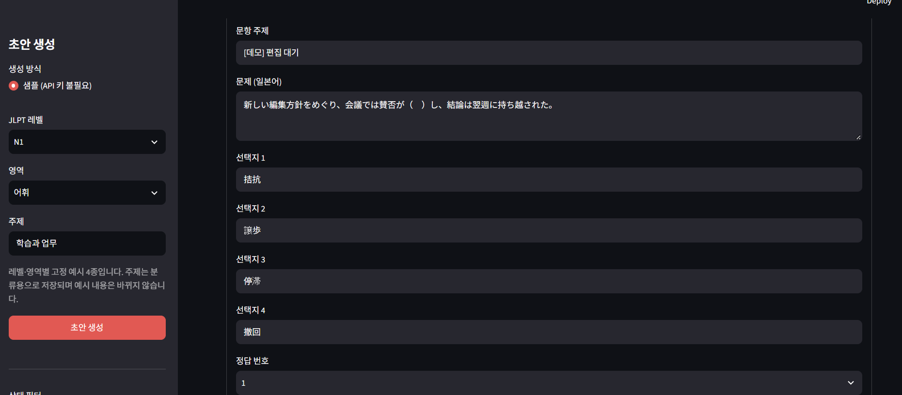
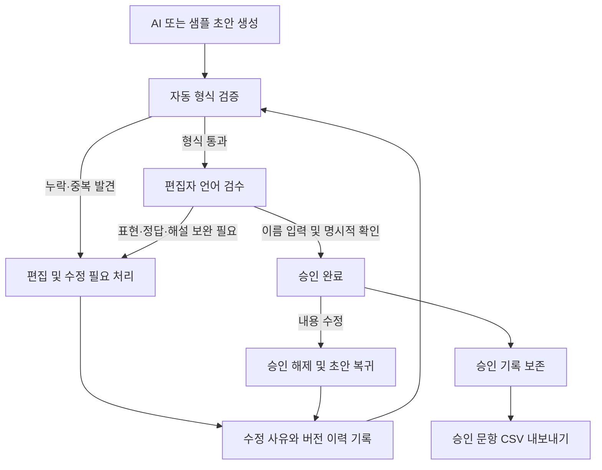
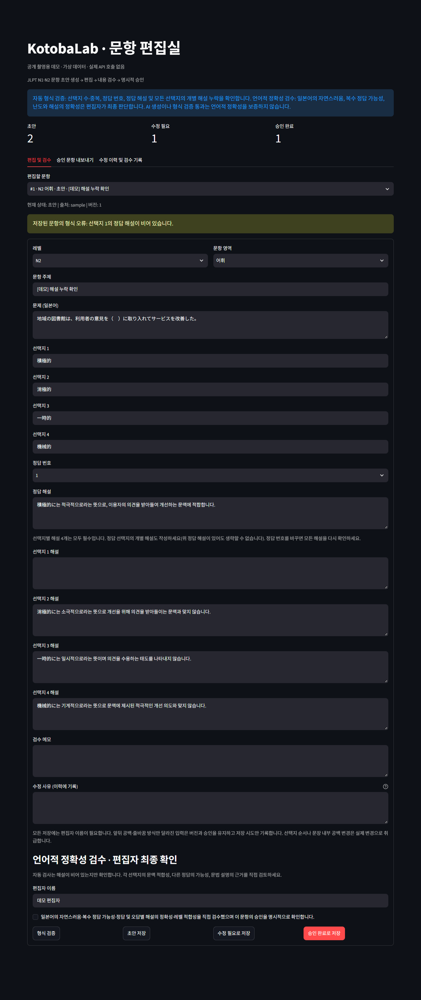
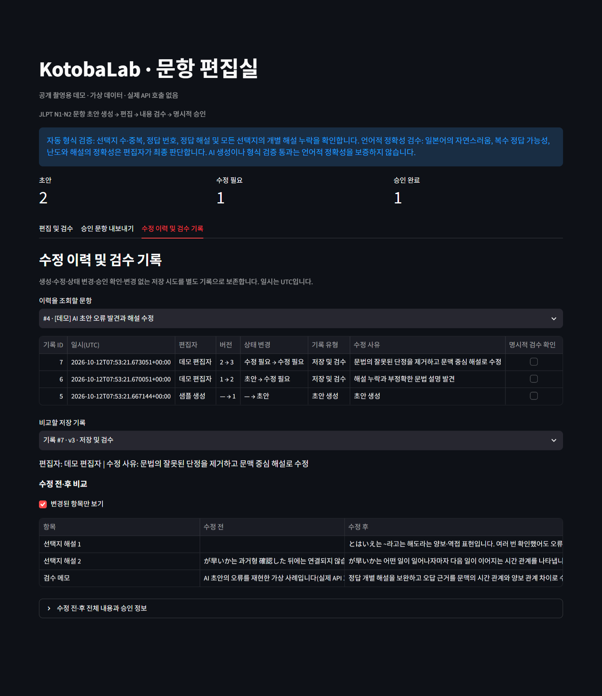
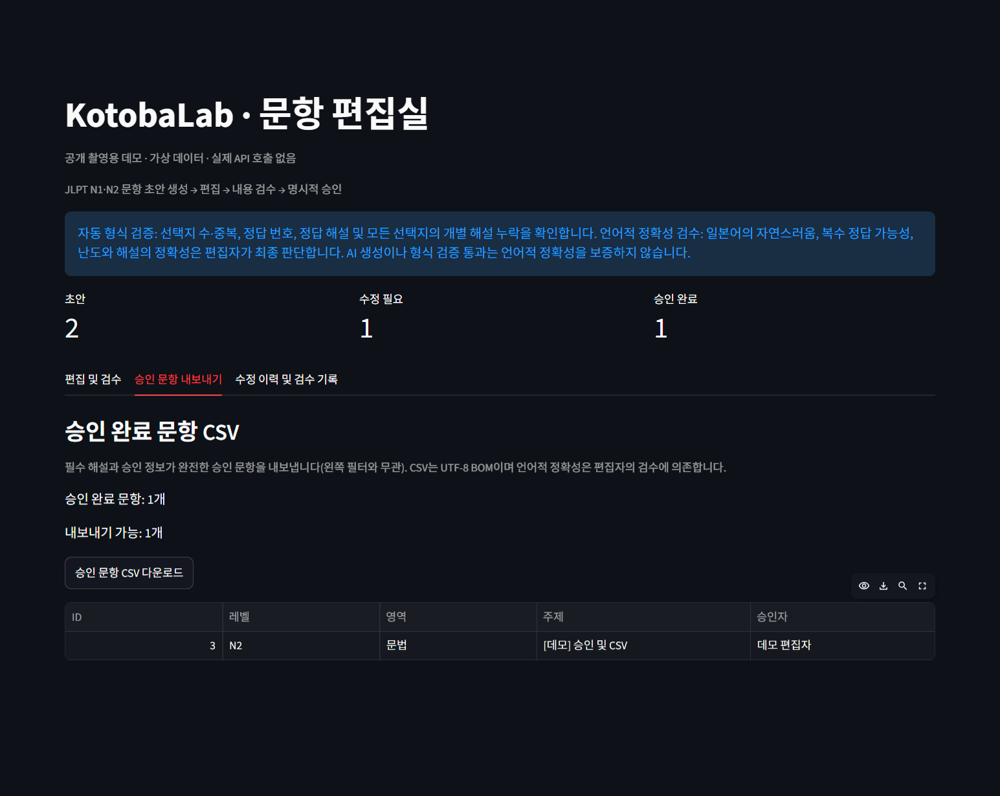

# KotobaLab

**일본어 교재 연구원과 편집자를 위한 AI 문항 생성·검수 도구**

JLPT N1·N2 어휘·문법 문항의 초안을 만들고, 편집자가 문제와 해설을 검토해 승인하는 웹 애플리케이션입니다. 문항을 수정한 과정은 버전별로 기록하고, 승인된 문항은 CSV로 내보낼 수 있습니다.

AI의 초안 생성과 편집자의 검수를 하나의 작업 흐름으로 연결하고자 개발했습니다. API 키 없이도 샘플 문항으로 편집·검수·승인 과정을 살펴볼 수 있습니다.



## 제작 동기

일본어 문항은 정답을 하나 지정하는 것만으로 완성되지 않습니다. 다른 선택지도 정답이 될 수 있는지, 오답이 학습 목표에 적절한지, 해설의 문법 설명이 정확한지 확인해야 합니다.

문항 초안을 검토하면서 이런 판단을 AI 생성 결과에 맡기기 어렵다는 점을 확인했습니다. 그래서 선택지 중복이나 해설 누락은 자동으로 검사하고, 일본어 표현과 정답의 유일성은 편집자가 판단하도록 역할을 나눴습니다. 수정 사유와 승인 기록도 남겨 문항을 다듬은 과정을 추적할 수 있게 했습니다.

## 주요 기능

| 기능 | 구현 내용 |
| --- | --- |
| 문항 초안 생성 | N1/N2, 어휘/문법, 주제를 선택해 4지선다 문항 생성 |
| 문항·해설 편집 | 문제, 선택지 4개, 정답 번호, 정답 해설과 선택지별 해설 수정 |
| 자동 형식 검증 | 선택지 중복·누락, 정답 번호 오류, 필수 해설 누락 검사 |
| 검수 상태 관리 | 초안·수정 필요·승인 완료 상태 관리, 편집자의 명시적 확인 후 승인 |
| 수정 이력 | 수정 전후 내용, 편집자, 수정 사유, 일시, 버전·상태 변경 조회 |
| CSV 내보내기 | 필수 해설과 승인 정보가 완전한 승인 문항 내보내기 |

## 문항 제작 흐름



AI가 생성한 문항은 초안으로 저장합니다. 형식 검증을 거친 뒤 편집자가 내용을 검토하고, 보완이 필요하면 수정 사유와 함께 기록합니다. 승인은 편집자 이름과 검수 확인이 있어야 가능합니다.

### 자동 검사와 편집자 검수

| 자동으로 검사하는 것 | 편집자가 판단하는 것 |
| --- | --- |
| 선택지 수, 중복·빈 값 | 선택지의 자연스러움과 학습 목표 적합성 |
| 정답 번호의 범위 | 정답의 유일성과 복수 정답 가능성 |
| 정답 해설과 개별 해설 4개의 누락 | 문법 설명과 각 오답의 근거 |
| 필수 항목의 입력 여부 | JLPT 레벨과 난도 |

정답 선택지의 개별 해설도 필수 항목으로 검사합니다. 형식 검증을 통과한 문항도 언어적 정확성은 편집자가 확인하도록 했습니다.



## 실제 검수 사례: 「以降・以来」

생성된 문항을 검토하면서, 정답과 선택지의 형식은 갖춰져 있지만 하나의 정답을 고르기 어려운 사례를 발견했습니다.

```text
彼は2020年4月入社（　）、ずっと同じ会社で働いている。

1. 以降   2. 以来   3. 以来以降   4. 以後
AI가 지정한 정답: 2번 以来
```

| 발견한 문제 | 검수 판단 |
| --- | --- |
| 복수 정답 가능성 | 以来는 과거의 시점부터 이어지는 상태에 적합하지만, 이 문장만으로 以降나 以後를 명확히 배제하기 어려웠습니다. |
| 부적절한 오답 | 以来以降은 표현을 단순 결합한 부자연스러운 선택지여서, 두 표현의 차이를 평가하는 오답으로 적절하지 않았습니다. |
| 해설의 과도한 단정 | “以降는 상태의 지속을 강조하는 문맥에 적합하지 않다”는 설명만으로 해당 선택지를 오답이라고 판단하기에는 근거가 부족했습니다. |

사전에서 以後·以降의 용법과 以来의 의미를 확인하고, 이 문항은 문맥과 선택지를 다시 설계한 뒤 재검수해야 한다고 판단했습니다. [小学館 사전 자료: 以後·以降 비교](https://kotobank.jp/word/%E4%BB%A5%E5%BE%8C-431678), [以来의 의미](https://kotobank.jp/word/%E4%BB%A5%E6%9D%A5-436281).

이 경험을 통해 **자연스러운 선택지를 구성하는 것과 각 오답을 배제할 근거를 설명하는 것이 모두 중요하다**는 검수 기준을 정리했습니다. KotobaLab에서는 이런 판단을 수정 필요 상태와 검수 메모로 남기고, 수정 전후 내용을 비교하며 다시 검수할 수 있습니다.

## 수정 이력 관리

문항 저장과 이력 기록을 하나의 SQLite 트랜잭션으로 처리했습니다. 저장 과정에서 오류가 발생하면 문항과 이력이 함께 취소되고, 이전 이력은 별도로 보존됩니다.

- 문제·선택지·정답·해설·검수 메모의 수정 전후 비교
- 편집자, 수정 사유, 일시, 버전과 상태 변경 기록
- 승인 문항의 내용 수정 시 승인 해제와 재검수 요구
- 앞뒤 공백이나 줄바꿈 방식만 달라진 저장은 기존 버전 유지
- 다른 편집 창에서 변경된 문항을 오래된 버전으로 저장하면 충돌 안내



## 기술 스택

| 기술 | 사용 목적 |
| --- | --- |
| Python 3.11 이상 | 애플리케이션 로직과 데이터 처리 |
| Streamlit | 문항 생성·편집·검수 화면 |
| OpenAI API | 문항 초안 생성 |
| Pydantic | 문항 데이터 모델과 구조화된 API 응답 |
| SQLite | 문항·검수 상태·수정 이력 저장 |
| Pandas | 승인 문항 CSV 생성 |
| pytest / Streamlit AppTest | 검수 규칙, 저장 처리, 화면 흐름 테스트 |

## 실행 방법

### 설치 및 샘플 모드 실행

저장소를 내려받은 뒤 프로젝트 루트에서 실행합니다. 다음 명령은 Windows PowerShell 기준입니다.

```powershell
py -3.11 -m venv .venv
.\.venv\Scripts\python.exe -m pip install -r requirements.txt
.\.venv\Scripts\python.exe -m streamlit run app.py
```

브라우저에서 <http://localhost:8501>을 열고 **샘플 (API 키 불필요)**를 선택하면 됩니다. 샘플은 직접 작성한 N1·N2 예시 4종이며, 샘플 모드의 주제는 분류용으로 저장됩니다.

### OpenAI API 사용

```powershell
Copy-Item .env.example .env
```

`.env`에 API 키를 입력하고 앱을 재시작한 뒤 **OpenAI API**를 선택합니다.

```dotenv
OPENAI_API_KEY=YOUR_API_KEY
OPENAI_MODEL=gpt-4.1-mini
```

API 호출에는 비용이 발생합니다. 모델은 `OPENAI_MODEL`로 설정하며 Structured Outputs를 지원하고 해당 계정에서 사용할 수 있어야 합니다. 연동은 [OpenAI 공식 Structured Outputs 문서](https://developers.openai.com/api/docs/guides/structured-outputs?api-mode=responses)를 참고했습니다.

### 기존 DB 마이그레이션

기존 데이터에 이력 기능을 적용할 때는 앱을 종료하고 백업·마이그레이션 스크립트를 실행합니다.

```powershell
.\.venv\Scripts\python.exe scripts\migrate_history.py
```

## 테스트 결과

**2026년 10월 12일 기준, 자동 테스트 109개 통과.**

```powershell
.\.venv\Scripts\python.exe -m pytest -q
```

형식 오류와 해설 누락, 승인 조건, 수정 후 승인 해제, CSV 내보내기, 이력 보존, 트랜잭션 롤백, 마이그레이션, 동시 편집 충돌, 화면 흐름을 검증했습니다. API 응답은 모의 데이터로 테스트하며, 문항의 언어적 품질은 편집자가 검수합니다.



## 프로젝트 구조

```text
app.py                    Streamlit 화면
kotobalab/                문항 모델·생성·검증·저장·이력·내보내기
tests/                    자동 테스트
scripts/                  DB 마이그레이션과 데모 데이터 준비
docs/screenshots/          화면 이미지와 데모 실행 안내
requirements.txt          의존성
.env.example              API 설정 예시
```

본문의 화면은 샘플 문항을 사용한 데모입니다. 별도 데모 실행과 화면 촬영 방법은 [데모·스크린샷 안내](docs/screenshots/README.md)에 정리했습니다.
